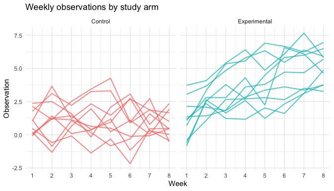
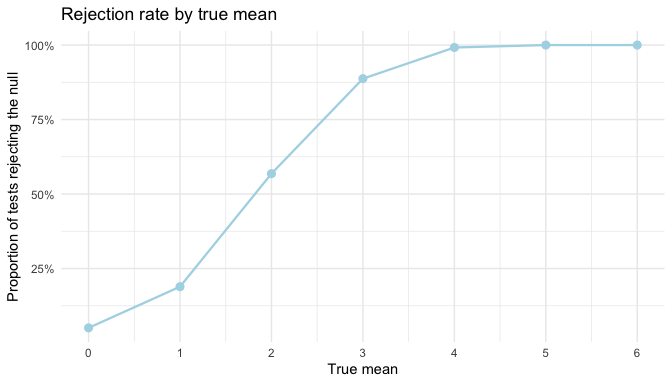
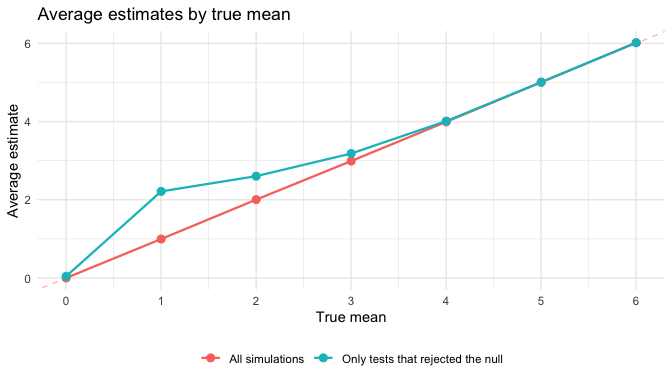

p8105 Homework5
================
Xinying Zou
2026-11-18

## Problem 1

``` r
shared_birthday = function(n){
  birthday = sample(1:365, size = n, replace = TRUE)
  any(duplicated(birthday))
}
```

``` r
set.seed(1)
birthday_result = tibble::tibble(
  group_size = 2:50,
  probability = purrr::map_dbl(group_size,\(n) mean(replicate(10000, shared_birthday(n)))
  )
)

head(birthday_result)
```

    ## # A tibble: 6 × 2
    ##   group_size probability
    ##        <int>       <dbl>
    ## 1          2      0.0024
    ## 2          3      0.0085
    ## 3          4      0.0167
    ## 4          5      0.0267
    ## 5          6      0.0399
    ## 6          7      0.0521

``` r
ggplot2::ggplot(
  birthday_result,
  ggplot2::aes(x = group_size, y = probability)
) +
  ggplot2::geom_hline(yintercept = 0.5, linetype = "dashed", color = "pink") +
  ggplot2::geom_line(color = "lightblue", linewidth = 1) +
  ggplot2::scale_y_continuous(labels = scales::label_percent()) +
  ggplot2::labs(
    title = "Probability of shared birthday",
    x = "Group size",
    y = "Estimated probability"
  ) +
  ggplot2::theme_minimal()
```

<!-- -->

The plot shows that shared birthdays become more likely as the group
gets bigger. The chance is about 50% with 23 people. By the time there
are 50 people, it goes up to about 97%.

## Problem 2

``` r
study_files = tibble::tibble(file_path = list.files(path = "data", pattern = "^(con|exp)_.*\\.csv$", full.names = TRUE))
```

``` r
study_files = study_files |>
  dplyr::mutate(
    weekly_data = purrr::map(file_path,\(path) readr::read_csv(path, show_col_types = FALSE))
  )
```

``` r
study_tidy = study_files |>
  dplyr::mutate(
    file_name = tools::file_path_sans_ext(basename(file_path))
  ) |>
  tidyr::separate_wider_delim(
    file_name, delim = "_", names = c("arm", "subject_id")
  ) |>
  dplyr::mutate(
    arm = factor(arm, levels = c("con", "exp"),labels = c("Control", "Experimental")
    )
  ) |>
  tidyr::unnest(weekly_data) |>
  tidyr::pivot_longer(
    cols = dplyr::starts_with("week_"),
    names_to = "week",
    names_prefix = "week_",
    names_transform = list(week = as.integer),
    values_to = "observation"
  ) |>
  dplyr::select(arm, subject_id, week, observation)

head(study_tidy, 8)
```

    ## # A tibble: 8 × 4
    ##   arm     subject_id  week observation
    ##   <fct>   <chr>      <int>       <dbl>
    ## 1 Control 01             1        0.2 
    ## 2 Control 01             2       -1.31
    ## 3 Control 01             3        0.66
    ## 4 Control 01             4        1.96
    ## 5 Control 01             5        0.23
    ## 6 Control 01             6        1.09
    ## 7 Control 01             7        0.05
    ## 8 Control 01             8        1.94

``` r
ggplot2::ggplot(
  study_tidy,
  ggplot2::aes(
    x = week,
    y = observation,
    group = interaction(arm, subject_id),
    color = arm
  )
) +
  ggplot2::geom_line(linewidth = 0.7, alpha = 0.75) +
  ggplot2::facet_wrap(ggplot2::vars(arm)) +
  ggplot2::scale_x_continuous(breaks = 1:8) +
  ggplot2::labs(
    title = "Weekly observations by study arm",
    x = "Week",
    y = "Observation"
  ) +
  ggplot2::theme_minimal() + ggplot2::theme(legend.position = "none")
```

<!-- -->

In control group, observations go up and down from week to week without
a clear trend. In experimental group, most participants’ values increase
over time. The two groups overlap in week 1, but by week 8 the
experimental group has higher values than the control group.

## Problem 3

``` r
simulate_t_test = function(true_mu){
  sample_values = rnorm(n = 30, mean = true_mu, sd = 5)
  t.test(sample_values, mu = 0, alternative = "two.sided") |>
    broom::tidy() |>
    dplyr::select(estimate, p.value)
}
```

``` r
set.seed(1)

t_test_result = tibble::tibble(true_mu = 0:6) |>
  dplyr::mutate(
    result = purrr::map(
      true_mu,
      \(mu) {
        replicate(5000, simulate_t_test(mu), simplify = FALSE) |>
          purrr::list_rbind()
      }
    )
  ) |>
  tidyr::unnest(result)
```

``` r
t_test_summary = t_test_result |>
  dplyr::mutate(rejected = p.value < 0.05) |>
  dplyr::group_by(true_mu) |>
  dplyr::summarise(
    rejection_rate = mean(rejected),
    mean_estimate = mean(estimate),
    mean_estimate_rejected = mean(estimate[rejected]),
    .groups = "drop"
  )

t_test_summary
```

    ## # A tibble: 7 × 4
    ##   true_mu rejection_rate mean_estimate mean_estimate_rejected
    ##     <int>          <dbl>         <dbl>                  <dbl>
    ## 1       0         0.0508     -0.000262                 0.0426
    ## 2       1         0.189       0.996                    2.21  
    ## 3       2         0.568       2.00                     2.60  
    ## 4       3         0.887       2.99                     3.18  
    ## 5       4         0.992       3.99                     4.01  
    ## 6       5         1           5.01                     5.01  
    ## 7       6         1           6.02                     6.02

``` r
ggplot2::ggplot(
  t_test_summary,
  ggplot2::aes(x = true_mu, y = rejection_rate)
) +
  ggplot2::geom_line(color = "lightblue", linewidth = 0.8) +
  ggplot2::geom_point(color = "lightblue", size = 2.5) +
  ggplot2::scale_x_continuous(breaks = 0:6) +
  ggplot2::scale_y_continuous(labels = scales::label_percent()) +
  ggplot2::labs(
    title = "Rejection rate by true mean",
    x = "True mean",
    y = "Proportion of tests rejecting the null"
  ) + ggplot2::theme_minimal()
```

<!-- -->

When the true mean is 0, the test rejects the null about 5% of the time.
It is close to the expected Type I error rate. As the true mean moves
farther from 0, power increases. It goes from about 19% at a true mean
of 1 to nearly 100% at a true mean of 4.

``` r
estimate_plot_data = t_test_summary |>
  tidyr::pivot_longer(
    cols = c(mean_estimate, mean_estimate_rejected),
    names_to = "simulation_group",
    values_to = "average_estimate"
  )
ggplot2::ggplot(
  estimate_plot_data, ggplot2::aes(x = true_mu, y = average_estimate, color = simulation_group)
) +
  ggplot2::geom_abline(
    intercept = 0, slope = 1, linetype = "dashed", color = "pink"
  ) +
  ggplot2::geom_line(linewidth = 0.8) +
  ggplot2::geom_point(size = 2.5) +
  ggplot2::scale_x_continuous(breaks = 0:6) +
  ggplot2::scale_color_discrete(
    breaks = c("mean_estimate", "mean_estimate_rejected"),
    labels = c("All simulations", "Only tests that rejected the null")
  ) +
  ggplot2::labs(
    title = "Average estimates by true mean",
    x = "True mean",
    y = "Average estimate",
    color = NULL
  ) +
  ggplot2::theme_minimal() +ggplot2::theme(legend.position = "bottom")
```

<!-- -->

Across all the simulations, the average estimates are pretty close to
the true means. When I only look at the tests that rejected the null,
the average estimate is about 2.2 when the true mean is 1. This happens
because, with a small positive effect, samples that happen to give a
larger estimate are more likely to reject the null. At a true mean of 0,
large positive and negative estimates cancel out. For larger true means,
almost every test rejects the null, so the two averages are close again.
