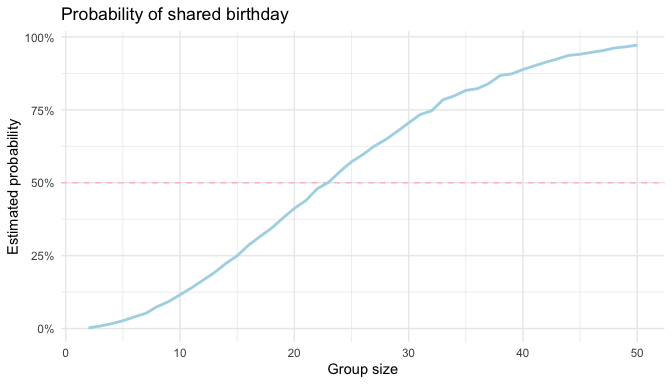

p8105 Homework5
================
Xinying Zou
2026-11-18

## Problem 1

``` r
shared_birthday = function(n){
  birthday = sample(1:365, size = n, replace = TRUE)
  any(duplicated(birthday))
}
```

``` r
set.seed(1)
birthday_result = tibble::tibble(
  group_size = 2:50,
  probability = purrr::map_dbl(group_size,\(n) mean(replicate(10000, shared_birthday(n)))
  )
)
```

``` r
ggplot2::ggplot(
  birthday_result,
  ggplot2::aes(x = group_size, y = probability)
) +
  ggplot2::geom_hline(yintercept = 0.5, linetype = "dashed", color = "pink") +
  ggplot2::geom_line(color = "lightblue", linewidth = 1) +
  ggplot2::scale_y_continuous(labels = scales::label_percent()) +
  ggplot2::labs(
    title = "Probability of shared birthday",
    x = "Group size",
    y = "Estimated probability"
  ) +
  ggplot2::theme_minimal()
```

<!-- -->

The plot shows that shared birthdays become more likely as the group
gets bigger. The chance is about 50% with 23 people. By the time there
are 50 people, it goes up to about 97%.

## Problem 2

## Problem 3
